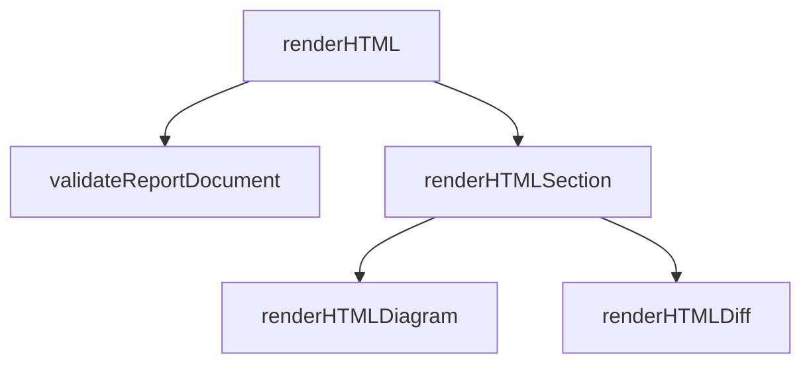

# Mate Show Me

Explain the current topic visually in a browser-rendered Mate report. Skip the preamble, keep prose brief, and pick the smallest report view that makes the key point clear.

## Subject

- With no argument, review the applied change when the user asks what a change did, or when the conversation is about work in the Working Repository and `git diff` there is not empty; otherwise explain the current topic. When both readings fit, review the change.
- With an argument naming a spec capability (`$ARGUMENTS`, for example `acme-capability`), explain that capability instead: read its canonical spec under `openspec/specs/` in the Companion Repository and report its purpose, its requirements, and the flow or structure they establish. Name the capability in the report `metadata`, include a `diagram` section, and omit the `diff` section.
- When the named capability has no canonical spec, say so, suggest close capability names from `openspec/specs/`, and write nothing: no report, no file.

## Mate Workflow

- Explanation only. Never write or edit source code, tests, documentation, OpenSpec artifacts, context files, or ADRs. The only file this skill produces is the report document handed to `mate report --input`; the CLI hosts or opens the rendered report.
- Draw from the repositories, not from memory. Every diagram and every diff line comes from the inspected repository state, never from recollection of the conversation. Use the available code-graph tools before broad source scans.
- Code lives in the Working Repository; the Companion Repository holds only artifacts. Run `git diff` in the Working Repository.
- Never put an absolute local path, home directory, username, machine name, temporary report path, Companion Repository path, or raw path-valued environment variable in the report. Use repository-relative paths or neutral labels such as `Working Repository` and `Companion Repository`.
- Never commit, push, or create a pull request.

## Browser Report Required

Always assemble and open a Mate report, even when a small inline sketch would be sufficient. Do not answer with an inline-only visual or paste the complete diagram or diff into the conversation. The final response should briefly state what the report shows, relaying the link or Studio instruction `mate report` printed, without repeating any temporary file path.

## Report Contents

- Show logic or an algorithm as a `diagram` section. Use a `mermaid` payload when branches, stages, or relationships benefit from a rendered visual; reserve `text` for compact pseudocode:

```text
on(save)
  if content is unchanged
    return cached result
  write new content
  return fresh result
```

- Show runtime control flow as a `diagram` section with a `mermaid` payload. Use `flowchart TD` for a call tree or control flow and `sequenceDiagram` when ordering between components matters:



- Show UI structure as a `diagram` section with a `mermaid` payload when showing relationships between components or modules. Use a `text` payload only when exact component syntax is the point, including the state boundaries that matter:

```tsx
<WorkflowView> (studio/views/workflow/index.tsx)
  workflowPlan(availableSkills)
  <StepList>
    <StepRow optional>
```

- Show file responsibility or a broad refactor as a `diagram` section with a `text` payload containing a shallow file tree:

```text
src/
|-- commands/      # parses user actions
|-- report/        # owns the report contract and renderer
`-- templates/     # ships assets and skills
```

- Show what changes as a `diff` section when the surrounding shape already exists. Match the diff shape to the topic - component tree, file layout, call tree, or control flow:

```diff
 on(save)
-  write content
+  if content is unchanged
+    return cached result
+  write new content
```

- Show a whole block in the report when most of it is new, when omitted context would hide ownership or order, or when the user needs a copyable target shape.

## Reviewing An Applied Change

- Read the change scope before drawing it, and draw the state after the change, not the one it replaced.
- Decide the diagram by what the change did. When it alters control flow or behaviour - new or changed branches, calls, ordering, return paths, or error handling - the first diagram is a `flowchart TD` of the resulting flow, limited to the part the change touches. A rename, a move, or an extraction that keeps behaviour identical gets one structure diagram and no flowchart.
- Mark new steps `added` and modified steps `changed`. Removed steps normally do not appear, since the diff shows what was there before; when removing a step is the point of the change, keep it as a `removed` node.
- When most of the drawn flow is new, marking every step carries no signal: mark at most the entry step `added`, and say in the caption that the flow is new.
- Keep a flowchart to about twelve nodes. Collapse a run of steps the change did not touch into one node instead of splitting the flow across several diagrams.
- When the change also alters structure - types, modules, or ownership - follow the flowchart with a structure diagram such as a `classDiagram`. A report carries at most two `diagram` sections, flowchart first, each with its own `caption`.
- Take the diff from `git diff` in the Working Repository. Keep only repository-relative paths in the patch, default to the working tree, and ask the user when their intent is a committed range instead.
- Run `git diff --numstat` over the same scope before choosing between the full diff and a curated report. Every excerpt is whole hunks copied unchanged from that diff.
- When the inspected scope has no changes, say so and omit the `diff` section. Never invent a patch.

## Browser Delivery

The report is mandatory. Prefer `mate report --input <temporary-json-file>` without `--json` so the CLI reads the complete document reliably and renders self-contained HTML. The CLI chooses the surface: inside a Studio terminal it hosts the report in Studio, elsewhere it opens it in the default browser. The CLI also supports `mate report --input -` when JSON is piped to stdin; if stdin delivery reports empty or truncated JSON, switch to a temporary JSON file rather than retrying the same transport. If validation fails, fix the report document and retry; do not fall back to an inline explanation or JSON-only delivery.

Deliver only through `mate report --input`. Never hand-write an HTML file, start a server, or open a browser yourself. Relay what the CLI prints: a full link when it prints one, otherwise its instruction to open Studio → Reports. Do not invent a link, and do not repeat any loopback address or credential.

## Assembling The Report

Build a JSON document that conforms to the `mate-create-report` contract, then hand it over:

1. Serialize the complete document to an OS temporary JSON file outside both repositories. Do not place the report input in the Working Repository or Companion Repository.
2. Run `mate report --input <temporary-json-file>`.

A report assembled by this skill carries:

- `metadata` naming the subject and a neutral repository label, never a local path
- `diagram` sections, even when the visual is small: one for a topic or capability report, one or two for a change review as Reviewing An Applied Change describes
- use a `mermaid` payload for runtime control flow, call trees, data flow, or component relationships; use `text` only when a sketch or pseudocode is clearer
- what changed, when there is something to diff: the complete unified diff in one `diff` section for a small change or when the user asks for it, otherwise a curated overview and excerpts as described in Curating A Large Diff
- a short Markdown `caption` on each `diagram` and `diff` section, saying what the reader should notice; do not repeat it in a separate `text` section
- a `text` section only for explanation that belongs to no single visual, with `"format": "markdown"` when it uses Markdown

A `diagram` section carries exactly one payload: `mermaid` for diagram source the report draws as a picture, or `text` for a monospace ASCII sketch or pseudocode block. A `diff` section carries a unified `patch` string. Both take an optional `caption`, rendered beneath the visual with the Markdown subset described in `mate-create-report`.

```json
{
  "id": "flow",
  "title": "Saving a document",
  "type": "diagram",
  "mermaid": "flowchart TD\n  save[save] --> check{unchanged?}\n  check -->|yes| cached[return cached]\n  check -->|no| write[write content]\n  class check,cached added\n  class write changed",
  "caption": "Unchanged content now **returns early** instead of being rewritten."
}
```

When a change also alters structure, the second `diagram` section is a structure diagram:

```json
{
  "id": "structure",
  "title": "Report rendering",
  "type": "diagram",
  "mermaid": "classDiagram\n  Renderer --> Highlight : uses",
  "caption": "`Renderer` is the only caller of `Highlight`."
}
```

```json
{
  "id": "changes",
  "title": "What changed",
  "type": "diff",
  "patch": "diff --git a/src/acme.ts b/src/acme.ts\n...",
  "caption": "Validation moves **before** rendering."
}
```

If the document fails contract validation, report the diagnostic and correct the document. Do not fall back to hand-written HTML.

## Curating A Large Diff

The reader already has the full diff in git; the report earns its place by choosing what is worth looking at.

- Measure first. Run `git diff --numstat` over the inspected scope and add the added and removed lines of every file; binary files count as zero.
- At or under 150 changed lines, or whenever the user asks for the full diff, include the complete unified diff in one `diff` section, whatever its size.
- Above 150 changed lines, curate:
  - one `table` section with id `changed-files` and the columns File | Added | Removed | Role, listing every changed file in the scope, including tests, snapshots, and generated files. Added and Removed are numbers; Role is a short phrase such as "contract: optional fields" or "snapshot hashes".
  - one to four focused `diff` sections with ids such as `diff-<topic>`, each making one point and carrying a `caption` that says why its hunks matter. Keep each section under about 60 lines.
  - a `summary` metric labelled "Changed lines shown" with the value `<shown> of <total>`, where shown counts the `+` and `-` lines in the excerpts and total is the `--numstat` sum.
- Excerpts stay verbatim. A focused patch is the file's `diff --git`, `---`, and `+++` header followed by one or more whole hunks copied unchanged from `git diff`. Never alter, merge, or invent hunk lines, and never elide lines with `...`. Two hunks of the same file may share a section when they make the same point.
- Leave supporting files out of the excerpts: tests (`*.test.*`, `*.spec.*`, `__tests__/`), snapshots (`__snapshots__/`, `*.snap`), lockfiles (`bun.lock`, `package-lock.json`, `pnpm-lock.yaml`, `yarn.lock`), generated files (`*.generated.*`), and formatting-only hunks. They still appear in the `changed-files` table. Excerpt them when the change is about them or the user asks for them.

```json
{
  "id": "changed-files",
  "title": "Changed files",
  "type": "table",
  "columns": ["File", "Added", "Removed", "Role"],
  "rows": [
    ["src/report/contract.ts", 48, 6, "contract: optional fields"],
    ["src/report/renderer.test.ts", 210, 95, "tests"]
  ]
}
```

```json
{
  "id": "diff-contract",
  "title": "Contract gains optional fields",
  "type": "diff",
  "patch": "diff --git a/src/report/contract.ts b/src/report/contract.ts\n--- a/src/report/contract.ts\n+++ b/src/report/contract.ts\n@@ -40,6 +40,8 @@\n...",
  "caption": "New fields are **optional**, so existing documents still validate."
}
```

## Mermaid Authoring Rules

- Use Mermaid whenever the user asks for a diagram or the subject has meaningful control flow, sequencing, lifecycle, or relationships. A `text` payload is a deliberate fallback, not the default for runtime flows.
- Pick the diagram type that matches the question: `classDiagram` for structure, `sequenceDiagram` for interaction between components, `stateDiagram-v2` for lifecycles, `flowchart TD` for control flow and call trees. For a change review, Reviewing An Applied Change decides the diagram instead.
- Keep labels short enough to read at report width. A label that needs a sentence belongs in the section's `caption`.
- Do not use ELK-only layouts or math labels. The report loads the single-file mermaid build from a CDN, which does not carry those chunks.
- To mark nodes, apply the report's theme classes `added`, `changed`, or `removed` with `class a,b added` or `a:::added`. They follow the reader's colour scheme. Never fix a colour with `classDef`, `style`, or `linkStyle`: a fill picked for a white page hides the labels in dark mode, so the dark copy drops those lines.
- Give each Mermaid visual a short `caption` that calls out the ownership boundary or invariant the reader should notice.
- Prefer the `text` payload for pseudocode, shallow file trees, or cases where a picture would genuinely obscure the point.
